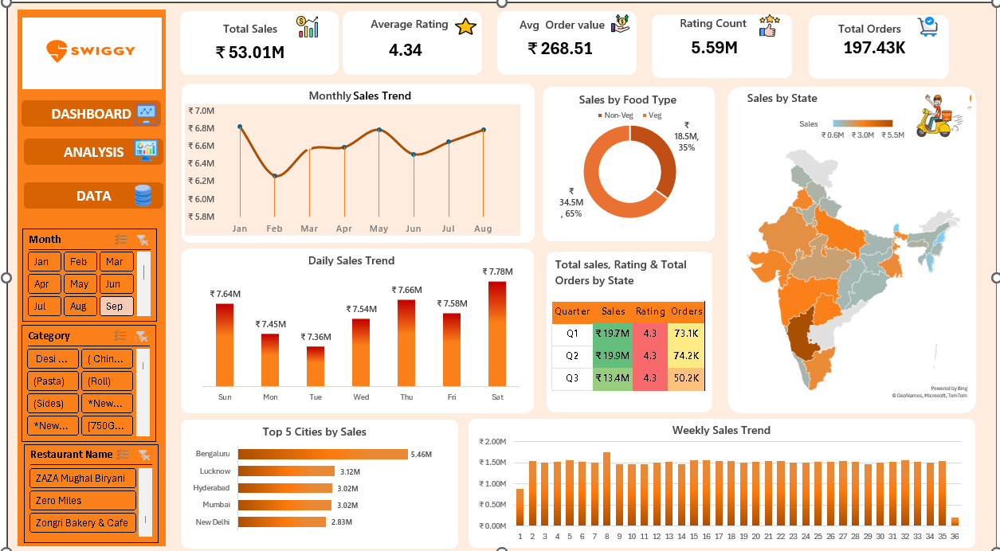

# Swiggy Sales Analysis Dashboard: Detailed Documentation

**An interactive Microsoft Excel dashboard analysing 197,430 food-delivery orders across 28 Indian states (Jan – Aug 2025).**


[](../Swiggy_Raw_Data_Excel.xlsx)

[← Back to Main README](../README.md)

---

## Quick Links

| Resource | Link |
|---|---|
| Interactive Dashboard (Excel workbook, open the **DASHBOARD** sheet) | [Open Dashboard](../Swiggy_Raw_Data_Excel.xlsx) |
| Insights Report (6-page PDF with charts) | [Open Insights Report](../Swiggy_Insights_Report.pdf) |
| Dashboard Screenshot | [View Screenshot](../dashboard.png) |
| Main project README | [Main README](../README.md) |
| My GitHub Profile | [github.com/abhishekgupta121](https://github.com/abhishekgupta121) |

---

## Table of Contents

1. [Project Overview](#project-overview)
2. [Objectives](#objectives)
3. [Dataset](#dataset)
4. [Tools and Techniques](#tools-and-techniques)
5. [Dashboard KPIs](#dashboard-kpis)
6. [Dashboard Visualizations](#dashboard-visualizations)
7. [Key Business Insights](#key-business-insights)
8. [Deeper Analysis](#deeper-analysis)
9. [Recommendations](#recommendations)
10. [Data Notes and Limitations](#data-notes-and-limitations)
11. [Project Structure](#project-structure)
12. [How to Use](#how-to-use)
13. [Learning Outcomes](#learning-outcomes)
14. [Author](#author)

---

## Project Overview

The Swiggy Sales Analysis Dashboard is a data analysis project built entirely in **Microsoft Excel**. It analyses **197,430** food order records from **January 2025 to August 2025** across Indian states and cities.

The workbook contains a raw data sheet, analysis sheets built with Pivot Tables, and an interactive dashboard. The dashboard uses KPI cards, Pivot Charts and Slicers to show sales performance over time, by food type, by geography and by quarter.

The project shows how raw transactional data can be turned into clear visuals that support business decisions.

---

## Objectives

- Analyse overall sales performance of Swiggy orders from January to August 2025.
- Track key metrics: Total Sales, Average Rating, Average Order Value, Rating Count and Total Orders.
- Study sales patterns by month, day of the week and week of the year.
- Compare Veg vs Non-Veg sales contribution.
- Identify top-performing states and cities by sales.
- Review quarterly sales, rating and order performance.
- Build an interactive dashboard with slicers for Month, Category and Restaurant Name.

---

## Dataset

| Attribute | Details |
|---|---|
| Total Records | 197,430 |
| Total Columns | 14 |
| Time Period | 01 Jan 2025 – 31 Aug 2025 (243 days) |
| Geography | 28 states / 28 cities |
| Restaurants | 993 |
| File Format | Microsoft Excel (.xlsx), sheet `Swiggy Data` |

### Column Description

| # | Column | Description |
|---|---|---|
| 1 | `State` | State where the order was placed |
| 2 | `City` | City where the order was placed |
| 3 | `Order Date` | Date of the order |
| 4 | `Day` * | Day of the week, derived from Order Date |
| 5 | `Quarter` * | Quarter of the year (Q1 / Q2 / Q3), derived from Order Date |
| 6 | `Week` * | Week number of the year, derived from Order Date |
| 7 | `Restaurant Name` | Name of the restaurant |
| 8 | `Location` | Area or locality of the restaurant |
| 9 | `Category` | Food category of the item |
| 10 | `Dish Name` | Name of the dish ordered |
| 11 | `Food Type` * | Veg or Non-Veg, derived from keywords in the dish name |
| 12 | `Price (INR)` | Price of the dish in Indian Rupees |
| 13 | `Rating` | Customer rating of the dish |
| 14 | `Rating Count` | Number of ratings received |

\* Calculated columns built with Excel formulas (`TEXT`, `WEEKNUM`, `IF`, `SEARCH`, `ISNUMBER`).

<details>
<summary>View the formulas used</summary>

```excel
Day        =TEXT([@[Order Date]], "ddd")
Quarter    ="Q" & INT((MONTH([@[Order Date]])-1)/3)+1
Week       =WEEKNUM([@[Order Date]])
Food Type  =IF(OR(ISNUMBER(SEARCH("chicken",[@[Dish Name]])),
                  ISNUMBER(SEARCH("egg",    [@[Dish Name]])),
                  ISNUMBER(SEARCH("fish",   [@[Dish Name]])),
                  ISNUMBER(SEARCH("mutton", [@[Dish Name]])),
                  ISNUMBER(SEARCH("biryani",[@[Dish Name]])),
                  ISNUMBER(SEARCH("kebab",  [@[Dish Name]])),
                  ISNUMBER(SEARCH("non veg",[@[Dish Name]]))),
               "Non-Veg", "Veg")
```

</details>

---

## Tools and Techniques

| Technique | Purpose |
|---|---|
| Pivot Tables | Summarising sales, ratings and orders by different dimensions |
| Pivot Charts | Creating visuals linked to the pivot tables |
| Slicers | Interactive filtering by Month, Category and Restaurant Name |
| Excel Formulas | Creating Day, Quarter, Week and Food Type columns; Average Order Value with `GETPIVOTDATA` |
| KPI Cards | Showing key business metrics at a glance |
| Map Chart | Showing sales by state on a map of India |
| Conditional Formatting | Colour scales in the Quarterly summary table |
| Interactive Dashboard | Combining all visuals and filters in one view |

---

## Dashboard KPIs

| Total Sales | Average Rating | Avg Order Value | Rating Count | Total Orders |
|:---:|:---:|:---:|:---:|:---:|
| **₹53.01M** | **4.34** | **₹268.51** | **5.59M** | **197.43K** |

---

## Dashboard Visualizations

| Visualization | Description |
|---|---|
| Monthly Sales Trend | Line chart of total sales from January to August |
| Daily Sales Trend | Column chart comparing total sales for each day of the week |
| Weekly Sales Trend | Column chart of total sales for each week number |
| Sales by Food Type | Donut chart of the Veg vs Non-Veg split |
| Sales by State | Map of India with a colour gradient from low to high sales |
| Top 5 Cities by Sales | Bar chart ranking the five highest-selling cities |
| Quarterly Summary | Table of Sales, Rating and Orders for Q1, Q2 and Q3 with colour scales |
| Interactive Filters | Slicers for Month, Category and Restaurant Name |

---

## Key Business Insights

- **Overall performance:** ₹53.01M in sales from 197.43K orders, with an average order value of ₹268.51.
- **Customer ratings:** Average rating is 4.34, and about 4.3 in each quarter.
- **Veg vs Non-Veg:** Veg contributes ₹34.5M (65%) of sales and Non-Veg ₹18.5M (35%).
- **Top cities:** Bengaluru leads with ₹5.46M, followed by Lucknow (₹3.12M), Hyderabad (₹3.02M), Mumbai (₹3.02M) and New Delhi (₹2.83M).
- **State-wise sales:** Karnataka appears in the darkest shade on the map, marking the highest sales range.
- **Day-wise sales:** Saturday has the highest total (₹7.78M) and Tuesday the lowest (₹7.36M); the gap is small (see Deeper Analysis).
- **Monthly trend:** Monthly sales stay between ₹6.2M and ₹6.8M, with the lowest total in February.
- **Quarterly view:** ₹19.7M in Q1, ₹19.9M in Q2 and ₹13.4M in Q3. Q3 covers only July and August, so it is a partial quarter.
- **Weekly trend:** Stable through most of the year; the first and last weeks are lower because they are partial weeks.

---

## Deeper Analysis

Findings from re-analysing the raw data, explained with charts in the [Insights Report (PDF)](../Swiggy_Insights_Report.pdf).

| # | Finding | Evidence |
|---|---|---|
| 1 | Weekday totals are slightly misleading: Mon and Tue occur 34 times, other days 35 times. Per day, **Saturday is best (₹222.4K)** and **Wednesday is weakest (₹215.5K)**, a spread of only about 3%. | 243 days analysed |
| 2 | February is not truly weak. It has the lowest total only because it has 28 days; per day it is the **strongest month (₹223.9K)**. | Average sales per day by month |
| 3 | Non-Veg orders are worth **32% more** (AOV ₹324 vs ₹246). Non-Veg is 29% of orders but 35% of sales. | 56,948 Non-Veg vs 140,482 Veg orders |
| 4 | Bengaluru leads through **volume, not basket size**: about 20K orders (roughly 4x a typical state) with an AOV of ₹272. Goa and Uttar Pradesh have the highest AOV (about ₹306). | State-level AOV |
| 5 | The **top 5 restaurants contribute 25.4%** of sales. KFC earns about ₹0.9M more than McDonald's on a similar order count because its AOV is 33% higher (₹328 vs ₹247). | 5 of 993 restaurants |
| 6 | Orders above ₹500 are **7.9% of items but 23.4% of sales**. | Price-band analysis |

---

## Recommendations

| Finding | Suggested Action |
|---|---|
| Basket size varies more than volume (Goa ₹306 vs Tripura ₹229) | Use bundles and free-delivery thresholds in low-AOV states |
| Non-Veg orders are worth 32% more than Veg | Cross-sell Non-Veg add-ons and combos where relevant |
| Orders above ₹500 generate 23% of sales | Promote family and party combos, especially on weekends |
| Five chains hold 25% of sales | Negotiate chain-level offers and support local restaurants to diversify supply |
| Daily demand is flat (about 3% spread) | Focus on menu, pricing and delivery speed rather than day-specific discounts |
| Rating is stuck at 4.3 | Set a 4.5 target and reward high-rated restaurants with visibility |

---

## Data Notes and Limitations

- **Q3 is a partial quarter.** Data ends on 31 Aug 2025, so Q3 should not be compared directly with Q1 or Q2. The Month slicer also lists Sep, which has no data.
- **Sampling effect.** Orders per state fall into near-fixed tiers (about 5K, 10K, and 20K for Karnataka), so city rankings partly reflect how many records each city contributed. Average order value is a fairer comparison.
- **22 Feb 2025 spike.** About 1,550 orders (₹430K) against roughly 800 on neighbouring days, 54% from Bengaluru. Likely a data-collection effect.
- **Food Type is keyword-based.** 656 prawn dishes (₹0.29M, about 0.5% of sales) are tagged Veg. The effect on the 65/35 split is small, but the keyword list should be corrected.
- **"Sales" means item price.** It excludes delivery fees, taxes and discounts.

---

## Project Structure

```text
Swiggy-Data-Analysis-Excel/
│
├── README.md                      # Main README
├── Swiggy_Raw_Data_Excel.xlsx     # Data, analysis and dashboard sheets
├── Swiggy_Insights_Report.pdf     # 6-page insights report
├── dashboard.png                  # Dashboard screenshot
│
└── Documentation/
    └── README.md                  # Detailed documentation (this file)
```

| Workbook Sheet | Purpose |
|---|---|
| `Swiggy Data` | Dataset with 197,430 records and 14 columns |
| `Analysis1` | Pivot tables and KPI calculations |
| `Sheet3` | Supporting pivot table |
| `DASHBOARD` | Final interactive dashboard |

---

## How to Use

1. Download [`Swiggy_Raw_Data_Excel.xlsx`](../Swiggy_Raw_Data_Excel.xlsx) from this repository.
2. Open it in Microsoft Excel 2016 or later (Microsoft 365 recommended, as the map chart needs it).
3. Go to the **DASHBOARD** sheet.
4. Use the **Month**, **Category** and **Restaurant Name** slicers to filter every visual. Ctrl + click selects multiple items.
5. Use **Analysis** and **Data** in the side panel to see the pivot tables and raw data.
6. Click the clear-filter icon on a slicer to reset it.

---

## Learning Outcomes

- Worked with a large dataset of 197K+ records in Microsoft Excel.
- Created calculated columns using Excel formulas.
- Built Pivot Tables and Pivot Charts to summarise data.
- Designed KPI cards that present key metrics clearly.
- Added Slicers to make a dashboard interactive.
- Chose the right chart for each type of data (trend, comparison, share and geography).
- Applied conditional formatting to highlight patterns.
- Organised a workbook into data, analysis and dashboard sheets.
- Turned raw data into business-friendly insights.

---

## Author

**Abhishek Gupta**
Aspiring Data Analyst | Microsoft Excel | Data Visualization

[](https://www.linkedin.com/in/abhishek-gupta-366b922a3/)
[](https://github.com/abhishekgupta121)
[](mailto:abhishekgupta87221@gmail.com)

| | |
|---|---|
| LinkedIn | [linkedin.com/in/abhishek-gupta-366b922a3](https://www.linkedin.com/in/abhishek-gupta-366b922a3/) |
| GitHub | [github.com/abhishekgupta121](https://github.com/abhishekgupta121) |
| Email | [abhishekgupta87221@gmail.com](mailto:abhishekgupta87221@gmail.com) |

---

## Conclusion

This project shows how Microsoft Excel can be used to analyse a large dataset and present the results in an interactive dashboard. It combines Pivot Tables, Pivot Charts, Slicers and KPI cards to cover sales, ratings and orders by time, food type, city and state. It reflects my skills in data analysis, data visualisation and dashboard design.

If you found this project useful, please consider giving the repository a star.
