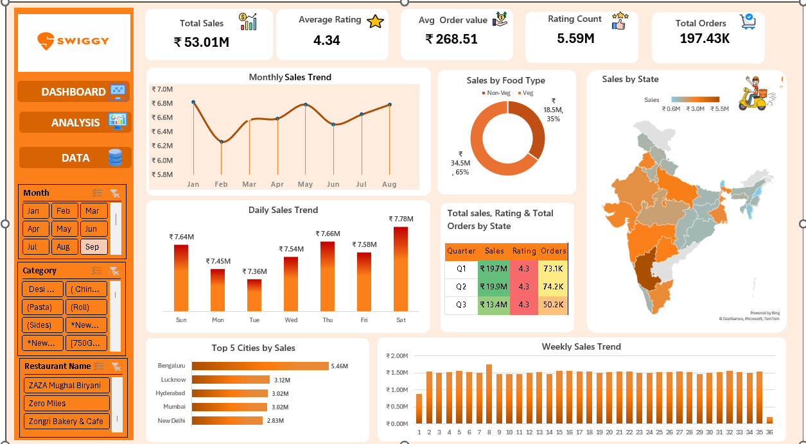

# Swiggy Sales Analysis Dashboard

**An interactive Microsoft Excel dashboard analysing 197,430 food-delivery orders across 28 Indian states (Jan – Aug 2025).**


[](Swiggy_Raw_Data_Excel.xlsx)

---

## Quick Links

| Resource | Link |
|---|---|
| Interactive Dashboard (open the **DASHBOARD** sheet in Excel) | [Open Dashboard](Swiggy_Raw_Data_Excel.xlsx) |
| Insights Report (6-page PDF with charts) | [Open Insights Report](Swiggy_Insights_Report.pdf) |
| Detailed Documentation (data dictionary, formulas, full analysis) | [Open Documentation](Documentation/README.md) |
| Dashboard Screenshot | [View Screenshot](dashboard.png) |

---

## Project Overview

This project is built entirely in **Microsoft Excel**. It analyses **197,430** food order records from **January to August 2025** across Indian states and cities. The workbook contains a raw data sheet, analysis sheets built with Pivot Tables, and an interactive dashboard with KPI cards, Pivot Charts and Slicers (Month, Category, Restaurant Name).

It shows how raw transactional data can be turned into clear visuals that support business decisions.

---

## Dashboard KPIs

| Total Sales | Average Rating | Avg Order Value | Rating Count | Total Orders |
|:---:|:---:|:---:|:---:|:---:|
| **₹53.01M** | **4.34** | **₹268.51** | **5.59M** | **197.43K** |

---

## Key Insights

- **Veg vs Non-Veg:** Veg contributes ₹34.5M (65%) of sales and Non-Veg ₹18.5M (35%). Non-Veg orders are worth 32% more (AOV ₹324 vs ₹246).
- **Top cities:** Bengaluru leads with ₹5.46M, followed by Lucknow (₹3.12M), Hyderabad (₹3.02M), Mumbai (₹3.02M) and New Delhi (₹2.83M). Bengaluru leads through order volume, not basket size.
- **Time patterns:** Monthly sales stay between ₹6.2M and ₹6.8M. Per day, Saturday is best (₹222K) and Wednesday weakest (₹215K), a spread of only about 3%.
- **Quarterly view:** ₹19.7M in Q1, ₹19.9M in Q2 and ₹13.4M in Q3 (partial: July and August only).
- **Restaurants:** The top 5 of 993 restaurants contribute 25.4% of sales. KFC leads with ₹4.25M.
- **Ratings:** Stable at about 4.3 in every quarter.

For the full analysis, recommendations and data limitations, see the [Detailed Documentation](Documentation/README.md) and the [Insights Report](Swiggy_Insights_Report.pdf).

---

## Tools and Techniques

Microsoft Excel, Pivot Tables, Pivot Charts, Slicers, Map Chart, KPI Cards, Conditional Formatting, and Excel formulas (`TEXT`, `WEEKNUM`, `IF`, `SEARCH`, `ISNUMBER`, `GETPIVOTDATA`).

---

## Project Structure

```text
Swiggy-Data-Analysis-Excel/
│
├── README.md                      # Main README
├── Swiggy_Raw_Data_Excel.xlsx     # Data, analysis and dashboard sheets
├── Swiggy_Insights_Report.pdf     # 6-page insights report
├── dashboard.png                  # Dashboard screenshot
│
└── Documentation/
    └── README.md                  # Detailed documentation
```

---

## How to Use

1. Download [`Swiggy_Raw_Data_Excel.xlsx`](Swiggy_Raw_Data_Excel.xlsx) from this repository.
2. Open it in Microsoft Excel 2016 or later (Microsoft 365 recommended, as the map chart needs it).
3. Go to the **DASHBOARD** sheet and use the **Month**, **Category** and **Restaurant Name** slicers to filter every visual.

---

## Author

**Abhishek Gupta**
Aspiring Data Analyst | Microsoft Excel | Data Visualization

[](https://www.linkedin.com/in/abhishek-gupta-366b922a3/)
[](https://github.com/abhishekgupta121)
[](mailto:abhishekgupta87221@gmail.com)

| | |
|---|---|
| LinkedIn | [linkedin.com/in/abhishek-gupta-366b922a3](https://www.linkedin.com/in/abhishek-gupta-366b922a3/) |
| GitHub | [github.com/abhishekgupta121](https://github.com/abhishekgupta121) |
| Email | [abhishekgupta87221@gmail.com](mailto:abhishekgupta87221@gmail.com) |

If you found this project useful, please consider giving the repository a star.
